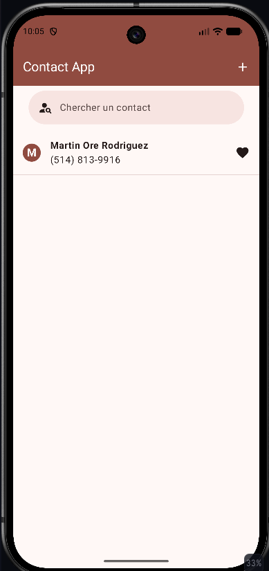
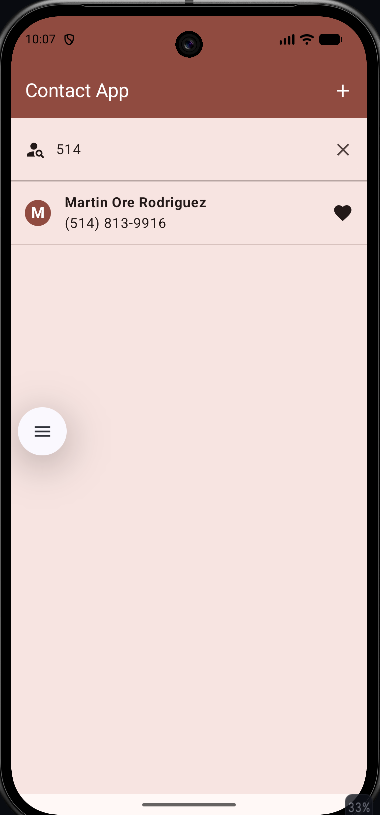
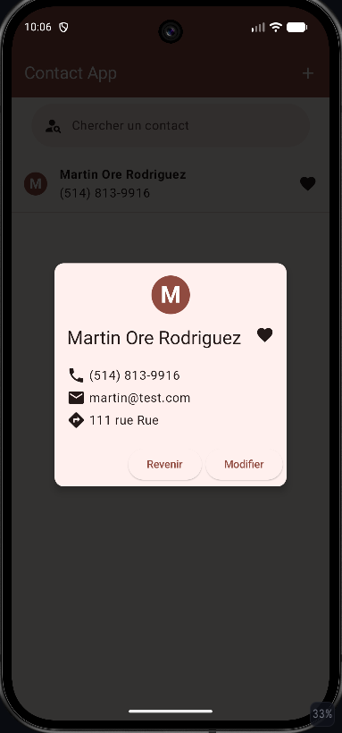
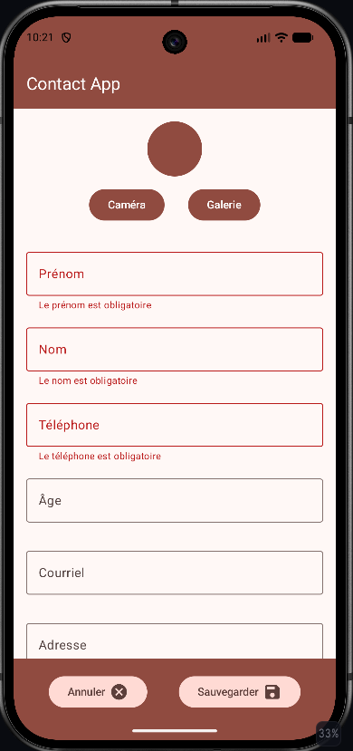
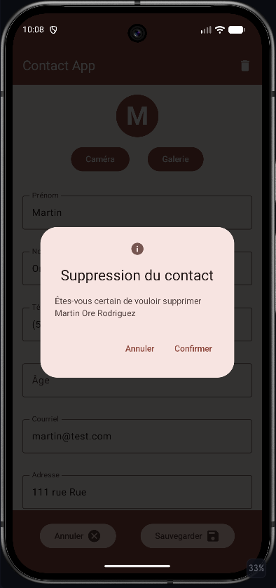

# BdeB-W26-ContactApp

Projet scolaire visant à développer une application mobile Android qui gère les contacts d'un utilisateur.

## Langage

Kotlin

## Technologies

Android Studio, Jetpack Compose, Room DB

## Fonctionnalités ajoutées

### Boîte AlertDialog

Un `AlertDialog` a été implémenté pour demander à l'utilisateur de confirmer la suppression d'un contact ou l'annulation de la modification d'un contact.

### Boîte Dialog avec Card

Une `Card` a été développée pour afficher les informations d'un contact indépendamment du formulaire de modification. Elle apparaît lorsque l'utilisateur touche un contact dans la liste. L'utilisateur peut alors choisir de modifier le contact, ce qui l'amène vers le formulaire, ou de revenir à la liste des contacts.

Grâce à l'utilisation d'un `Dialog` (et d'un `AlertDialog`), les informations importantes sont présentées au centre de l'écran. De plus, ces composants gèrent déjà le rappel `onDismissRequest()`, qui s'active lorsque l'utilisateur touche à l'extérieur de la boîte.

### Barre de recherche

Une barre de recherche a été implémentée sur la page principale de l'application, en haut de la liste des contacts. Elle permet de chercher un contact par son nom ou par un attribut qui lui est lié, comme un numéro de téléphone ou une adresse.

Lorsque l'utilisateur touche la barre de recherche, celle-ci occupe tout l'écran et affiche une sous-liste des contacts correspondant à la recherche. L'utilisateur peut toucher un contact pour afficher ses informations dans une boîte `Dialog` avec `Card`.

### Affichage standard d'un numéro de téléphone

Lorsque l'utilisateur sauvegarde un numéro de téléphone, celui-ci est enregistré sous forme numérique seulement. Cependant, une classe a été implémentée pour afficher le numéro dans le format standard `(111) 111-1111`. De plus, une validation oblige l'utilisateur à entrer un numéro de 10 chiffres (standard nord-américain).

### Thème personnalisé

Un thème personnalisé a été créé à l'aide de Material Theme Builder. Le fichier exporté se trouve à la racine du projet, et les couleurs et styles extraits sont utilisés dans l'application.

## Fonctionnalités manquantes

Bien que cette application soit modeste, des fonctionnalités utiles pourraient être ajoutées dans le futur. Par exemple, une validation plus poussée de l'adresse entrée par l'utilisateur, ainsi que l'ouverture de Google Maps avec l'adresse en paramètre lorsque l'utilisateur la touche.

On pourrait aussi permettre de lancer un appel en touchant l'icône à côté du numéro de téléphone d'un contact.

## Exemple d'utilisation de l'application

